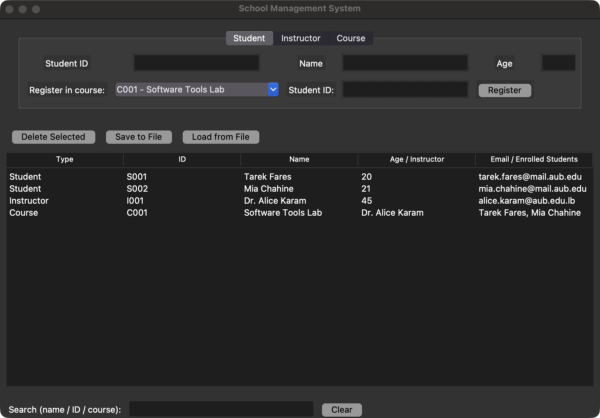
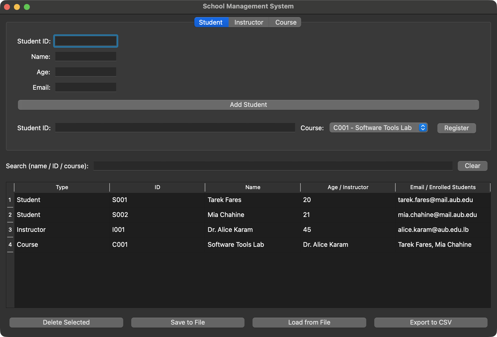
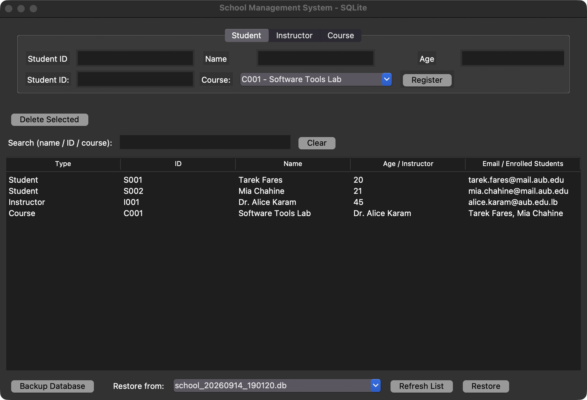

# Lab4-MajdAyash — School Management System (Tkinter + PyQt5)

A School Management System built in Python with two graphical interfaces, **Tkinter** and **PyQt5**, on top of one shared object-oriented data model. A SQLite-backed version and Sphinx documentation are included as well.

**Author:** Majd Ayash (solo project, so every commit was pushed by Majd Ayash)

## Project structure

| File / folder | Description |
|---|---|
| `main.py` | Launcher that opens the Tkinter GUI, the PyQt5 GUI or the database GUI |
| `part1_oop.py` | Shared data model: `Person`, `Student`, `Instructor`, `Course`, `SchoolManager` (validation and JSON save/load) |
| `part2_tkinter.py` | Tkinter GUI: add/edit/delete, register and assign, Treeview, search, save/load |
| `part3_pyqt.py` | PyQt5 GUI: the same features in tabs and a `QTableWidget`, plus CSV export |
| `part4_database.py` | SQLite database layer (`SchoolDB`) with a Tkinter GUI, backup and restore |
| `docs/` | Sphinx documentation for every module |
| `screenshots/` | Screenshots of each GUI |

## How Tkinter and PyQt work together

- Both GUIs import the **same classes** from `part1_oop.py`. Students, instructors, courses and their validation rules are written once and reused by both.
- Both GUIs save to and load from the **same `school_data.json` file**. You can add data in the Tkinter app, click **Save**, open the PyQt app and click **Load** to see the same data (and the other way round).
- `main.py` opens either interface from one place. Each GUI runs in its own process because Tkinter and PyQt5 cannot share one event loop.

## Requirements

- Python 3.10+ (Tkinter is bundled with Python)
- PyQt5

```bash
pip install -r requirements.txt
```

## How to run

```bash
python main.py            # opens a chooser window
python main.py tkinter    # Tkinter GUI
python main.py pyqt       # PyQt5 GUI
python main.py database   # SQLite database GUI
python main.py demo       # console demo of the OOP model
```

You can also run each part directly, for example `python part2_tkinter.py`.

## Building the documentation

```bash
cd docs
make html        # output in docs/build/html/index.html
```

## Screenshots

| Tkinter | PyQt5 | Database |
|---|---|---|
|  |  |  |

## Version control

The project is managed with Git and hosted on GitHub. Because this is a solo project, all work was committed directly to `main`, without feature branches or pull requests, as allowed for solo students in the Lab 4 instructions. The final version is tagged `v1.0` and published as a GitHub Release.
